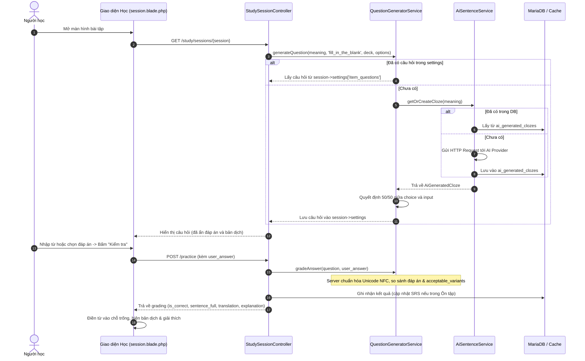

# Tính năng Đặt câu Điền từ bằng AI (AI Sentence Generation for Cloze Exercises)

Tài liệu hướng dẫn cấu hình, kiến trúc và vận hành tính năng tự động tạo câu điền từ bằng AI trong PolyVocab.

---

## 1. Tổng quan

Tính năng cho phép PolyVocab sử dụng các dịch vụ AI (hỗ trợ chuẩn OpenAI API hoặc Google Gemini) để tạo câu ví dụ kèm chỗ trống (`[ ______ ]`) dựa trên các nét nghĩa từ vựng cụ thể mà người dùng đang luyện tập hoặc ôn tập.

### Các điểm nổi bật:
- **Tùy chọn minh bạch trên giao diện**: Checkbox "Dùng AI đặt câu" đặt ngay cạnh dạng bài "Điền từ", mặc định tắt, chỉ bật được khi chọn dạng Điền từ và khi hệ thống đã thiết lập API key.
- **Hai hình thức trả lời (Tỷ lệ 50/50)**:
  1. *Nhập từ*: Người học gõ từ vào ô trống.
  2. *Trắc nghiệm 4 đáp án*: Chọn 1 trong 4 đáp án (1 đáp án đúng + 3 phương án nhiễu do AI sinh ra).
- **Tính ổn định của câu hỏi**: Định dạng câu hỏi, đáp án và thứ tự lựa chọn được lưu trong session setting ngay khi khởi tạo câu hỏi. Tải lại trang (F5) không làm thay đổi câu hỏi, không đổi giữa nhập từ và trắc nghiệm.
- **Chấm điểm an toàn phía máy chủ**: Không gửi đáp án hoặc bản dịch câu về trình duyệt trước khi người học nộp bài. Chấm điểm server-side chuẩn hóa Unicode NFC, khoảng trắng, chữ hoa/thường và chấp nhận các biến thể hợp lệ (acceptable variants).
- **Tối ưu chi phí và chống trùng lặp**: Lưu trữ các câu đã tạo vào bảng `ai_generated_clozes` để tái sử dụng; khóa đồng thời (concurrency lock qua `Cache::lock`) ngăn chặn nhiều request tạo trùng cùng lúc.

---

## 2. Cấu hình dịch vụ AI

### 2.1. Cấu hình trong `.env`

Thêm các biến môi trường sau vào file `.env` (không đưa khóa bảo mật thật vào Git hay repository):

```dotenv
# Bật/tắt tính năng AI
AI_ENABLED=true

# Nhà cung cấp: 'openai' (mặc định) hoặc 'gemini'
AI_PROVIDER=openai

# Khóa API của nhà cung cấp dịch vụ AI
AI_API_KEY=your_api_key_here

# Mô hình sử dụng (ví dụ: gpt-4o-mini, gpt-3.5-turbo, gemini-1.5-flash)
AI_MODEL=gpt-4o-mini

# Điểm cuối tùy chỉnh (nếu dùng proxy hoặc Azure OpenAI / Ollama / Local AI)
AI_ENDPOINT=https://api.openai.com/v1/chat/completions

# Thời gian chờ tối đa (giây)
AI_TIMEOUT=15
```

### 2.2. Kiểm tra trạng thái thiết lập
- Khi `AI_ENABLED=false` hoặc thiếu `AI_API_KEY`:
  - Màn hình Luyện tập và Ôn tập sẽ hiển thị nhãn `Chưa thiết lập AI`.
  - Checkbox "Dùng AI đặt câu" sẽ bị vô hiệu hóa (disabled), tránh phát sinh lỗi khi người học bắt đầu học.
  - Hệ thống tự động sử dụng câu ví dụ biên soạn sẵn nếu có.

---

## 3. Cấu trúc dữ liệu & Bảng cơ sở dữ liệu

### Bảng `ai_generated_clozes`
Bảng lưu trữ các câu đã sinh để tái sử dụng:

| Cột | Kiểu | Mô tả |
|---|---|---|
| `id` | BIGINT UNSIGNED | Khóa chính tự tăng |
| `entry_meaning_id` | BIGINT UNSIGNED | Khóa ngoại liên kết `entry_meanings` |
| `learning_language_id` | BIGINT UNSIGNED | Khóa ngoại liên kết `languages` (ngôn ngữ đang học) |
| `term` | VARCHAR(255) | Từ/cụm từ gốc |
| `meaning` | TEXT | Nghĩa cụ thể của từ |
| `sentence_full` | TEXT | Câu hoàn chỉnh do AI đặt |
| `sentence_with_blank` | TEXT | Câu có đúng một vị trí `[ ______ ]` |
| `blank_answer` | VARCHAR(255) | Đáp án chính xác tại chỗ trống |
| `acceptable_variants` | JSON | Các biến thể được chấp nhận (số nhiều, chia thì...) |
| `translation` | TEXT | Bản dịch câu sang ngôn ngữ giải nghĩa |
| `explanation` | TEXT | Lời giải thích ngắn ngữ cảnh |
| `distractors` | JSON | Mảng ít nhất 3 phương án nhiễu hợp lệ |
| `created_at` / `updated_at` | TIMESTAMP | Thời gian tạo và cập nhật |

---

## 4. Quy trình xử lý và Chấm điểm



---

## 5. An toàn và Bảo mật

1. **Không rò rỉ API Key**: Toàn bộ thao tác gọi AI diễn ra tại máy chủ Backend thông qua Laravel HTTP Client (`Illuminate\Support\Facades\Http`). Tuyệt đối không để lộ Key ra Blade view, JavaScript hay Git repository.
2. **Bảo vệ dữ liệu người dùng**: Payload gửi lên AI chỉ bao gồm: từ vựng, từ loại, nét nghĩa, ngôn ngữ học và ngôn ngữ giải nghĩa. Không gửi thông tin người dùng, tài khoản hay bộ từ riêng tư khác.
3. **Phòng chống Prompt Injection**: Dữ liệu từ và nghĩa được đóng gói theo dạng chuỗi giá trị và yêu cầu AI trả về định dạng JSON thuần túy theo schema có sẵn.
4. **Kiểm tra tính hợp lệ đầu ra (Schema Validation)**:
   - Câu phải chứa chính xác một chỗ trống dạng `[ ______ ]`.
   - Đáp án điền khuyết không được rỗng và phải xuất hiện trong câu hoàn chỉnh.
   - Có tối thiểu 3 phương án nhiễu khác nhau và khác đáp án đúng.
   - Có bản dịch và lời giải thích.
   - Nếu phản hồi từ AI không hợp lệ, hệ thống tự động fallback an toàn về câu ví dụ đã có trong hệ thống.

